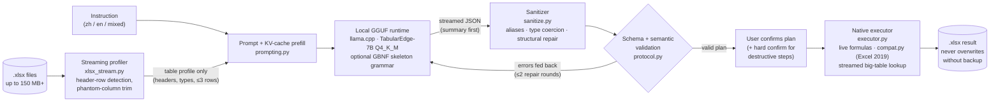

<div align="center">

# TabularEdge-7B

**Privacy-First Edge LLM & Native Execution Engine for Local Spreadsheets**

*A 7B model that turns plain-language spreadsheet requests (Chinese / English / mixed) into a validated Action Plan, plus a deterministic engine that runs that plan on real `.xlsx` files. Everything runs offline on a laptop with a 4 GB GPU.*

[Model Card](MODEL_CARD.md) · [Architecture](docs/ARCHITECTURE.md) · [Benchmarks](#edge-first-benchmarks) · [Quickstart](#quickstart) · [中文要点](#中文要点)

   

</div>

---

## Project Overview

Finance, government and healthcare teams spend much of their day in Excel. The data they handle (payroll, patient lists, registries, bank statements) often **may not leave the machine**. Cloud copilots are ruled out by policy. Generic local LLMs can chat about Excel, but they cannot reliably change a workbook.

TabularEdge-7B is built for that setting:

| Constraint | How TabularEdge handles it |
|---|---|
| **Data must not leave the device** | The model only sees a *table profile*: header names, column types and at most 3 sample rows. Full table data goes only through the local executor. There are no network calls besides `127.0.0.1`. |
| **Commodity hardware** | Q4_K_M GGUF (4.36 GiB). 21 of 28 layers run on an RTX 3050 **4 GB** laptop GPU and the rest on CPU, at about 17 tok/s. A CPU-only fallback runs at about 8.5 tok/s. |
| **LLMs make mistakes** | The model never writes code. It emits a typed **Action Plan** (JSON, 20 ops). Each plan is sanitized, schema-validated and semantically checked before anything runs. Destructive steps always ask for confirmation, and overwrites are backed up first. |
| **Real-world files are huge and messy** | A pure-stdlib **streaming OOXML reader** profiles a 150 MB, 761k-row workbook in about 0.1–0.3 s. It also handles title rows, phantom formatted columns and text-vs-number keys. |
| **Weight edits need a stop rule** | Three ROME rank-one edits were kept only after passing a gate: no function family regresses, perplexity stays within tolerance, first-token specificity ≥ 17/18. **Three further edits and a repetition-neuron ablation failed that gate and were rejected**, and both negative results are reported in the [model card](MODEL_CARD.md#procedure). |
| **Old Office installs** | A **compatibility layer** rewrites Excel 365 functions (XLOOKUP / UNIQUE / FILTER …) into Excel 2019-safe formulas, or writes computed values when no rewrite exists. |

### What it is good at (and what it is not)

TabularEdge-7B is a specialist. **Honest capability boundary:**

✅ **In scope:** single-table and two-table work on a 4 GB / offline machine
- data cleaning: trim, regex replace, fill empty, dedupe, delete rows with confirmation
- regex extraction (wrapped in `IFERROR`, so missing values come out blank instead of `#N/A`)
- cross-column calculation as **live formulas** (`=[单价]*[数量]` → `=C2*D2`)
- standard lookups (`XLOOKUP`, or `INDEX/MATCH` on Excel 2019) against a reference workbook, including a **streamed** lookup against reference tables of hundreds of MB
- conditional formatting, number formats, group-by aggregation (live `SUMIFS` formulas), filter / unique to new sheet, split into files, folder and workbook operations
- asking a clarifying question when an instruction is ambiguous (86.7 % recall on a hand-written test set)

❌ **Out of scope / known limits**
- **Long multi-branch business rules across 4+ tables in one sentence.** A 7B model does not plan these reliably in one shot. Split them into steps; each result file can be chained into the next instruction.
- **There are no hand-written phrase templates.** If the model does not understand an instruction, the client shows *which step failed and why* and refuses to run it. It does not guess.
- In-place editing of a main table above about 3 M cells. The client explains this before running and does not attempt to load such a table. Lookups *against* big tables are supported.
- Regex character classes are a weak spot. Example: "remove brackets" sometimes covers only `()`/`（）` and misses `【】`.

---

## Architecture Pipeline



| Layer | Module | Highlights |
|---|---|---|
| **Streaming reader** | [`tabularedge/xlsx_stream.py`](tabularedge/xlsx_stream.py) | `zipfile` + byte-level regex, no openpyxl / lxml. Sheet dims come from `<dimension>` in milliseconds. Shared strings are resolved **lazily**, only the indices actually used. Big-table lookup runs in **three streaming passes** (find key strings → scan only key/return columns → resolve hits), so memory scales with the number of *keys*, not with table size. |
| **Prompt / runtime** | [`tabularedge/prompting.py`](tabularedge/prompting.py), [`client/engine.py`](client/engine.py) | Prompts match the training format byte for byte. The profile is pushed into llama-server's KV cache when a file is selected, so the first token arrives in about 0.2 s. The engine auto-selects GPU layers from free VRAM and falls back CUDA → fewer layers → Vulkan → CPU. A Windows Job Object makes sure `llama-server` dies with the app. |
| **Sanitizer** | [`tabularedge/sanitize.py`](tabularedge/sanitize.py) | **Schema-driven, lenient normalization before validation** (the "parse, don't validate" pattern used by TypeChat/Instructor). It walks the JSON Schema (`$ref`, `oneOf`, `enum`, `pattern`, `additionalProperties`). It maps aliases (`font_weight: "bold"` → `bold: true`, `background` → `fill_color`, `operator` → `cmp`) and colors (`"浅绿"`, `#RGB`, ARGB, `rgb()`). It coerces types (`"true"`, `700` → bool), fixes structure (step re-numbering with `depends_on` remap, flattened args moved back under `args`, unknown fields dropped) and **never touches an already-valid plan**, which was verified on 110 recorded plans. |
| **Validation + repair** | [`tabularedge/protocol.py`](tabularedge/protocol.py), [`tabularedge/llm_parser.py`](tabularedge/llm_parser.py) | Checks the schema, then semantics: every column and sheet reference must exist, a row formula may not pin to a fixed cell (`=H2`), and a new column may not be named just `"F"`. Errors go back to the model as targeted repair prompts, and the best attempt is kept. Purely cosmetic steps that still fail are dropped. Anything else fails loudly with a per-step explanation. |
| **Executor** | [`tabularedge/executor.py`](tabularedge/executor.py) | 20 ops. `[Column]` templates are expanded into A1 refs. Formula references are re-anchored after row deletes and sorts, following Excel's semantics. `_xlfn.` prefixes are added for about 40 newer functions (without them Excel shows `#NAME?`). Formatting-only tail columns are trimmed and merged ranges shrunk. Path sandbox. |
| **Excel 2019 compat** | [`tabularedge/compat.py`](tabularedge/compat.py) | `XLOOKUP` → `IFERROR(INDEX/MATCH)`; approximate match → `INDEX/MATCH+MAXIFS`, which needs no sorted range; `UNIQUE` → a classic `INDEX/MATCH/COUNTIF` array formula that stays live. Functions with no rewrite are written as computed values and noted in the log. |
| **Formula evaluator** | [`tabularedge/formula_eval.py`](tabularedge/formula_eval.py) | 90 Excel functions in pure Python. It lets the executor group, filter or split on columns that are formulas, and lets tests check *computed* results instead of formula text. |

More detail: [docs/ARCHITECTURE.md](docs/ARCHITECTURE.md).

---

## Edge-First Benchmarks

Unless noted, all numbers were measured on the reference edge machine: **i7-11800H · 32 GB RAM · RTX 3050 Laptop 4 GB · Windows · Excel 2019**, running `llama.cpp b12119` with `TabularEdge-7B-Q4_K_M.gguf` at temperature 0.

### 1. Large workbook: 150 MB / 761,507 rows

The workload is a real government registry export: 150 MB, 761,507 rows × 25 columns, 3.35 M unique shared strings, 165 MB uncompressed. It is not distributed. [`test_cases/make_big.py`](test_cases/make_big.py) generates a synthetic table of the same scale.

| Operation | Baseline | TabularEdge |
|---|---|---|
| Open the file to show its structure | `openpyxl` `read_only=True`: **67 s** (parses all of `sharedStrings.xml` up front) | **0.22–0.29 s** |
| Instruction → first model token (big table as main file) | UI froze ("Not Responding") | **0.20 s** with KV prefill; summary at 1.0 s, full plan at 5.7 s |
| Lookup: 2,000-row list × 761k-row reference, 2 return columns | n/a | **22–23 s**, 1000/1000 true keys hit, 0/1000 false keys hit |
| Peak memory during the lookup | n/a | **86 MB** RSS on the synthetic table (< 100 MB) |
| Longest UI-thread stall during parse + run | 25–34 s | **0.11 s** (10 ms heartbeat probe) |

Reproducible on any machine with the synthetic generator. It produces the same shape (761,507 rows × 25 columns), but at 105 MB, because its strings are shorter than the real data:

```bash
python test_cases/make_big.py /tmp/big
python benchmarks/bench_stream.py /tmp/big
```

| Synthetic table on a **1-vCPU / 3 GB RAM VPS** ([`results/bench_stream_vps.json`](results/bench_stream_vps.json)) | |
|---|---|
| open + sheet dimensions | 0.002 s |
| header + first 200 rows (lazy shared strings) | 0.062 s |
| 2,000-key lookup over 761k rows, 2 return columns | 15.6 s, 1000/1000 hits, no false positives |
| peak RSS of the whole process | **80.6 MB** |

### 2. Model accuracy: plan *execution* equivalence

A plan counts as correct only if executing it produces **the same workbook** as the gold plan. Matching JSON text is not enough.

| Test set | Rule baseline | v1 (SFT only) | **TabularEdge-7B** |
|---|---|---|---|
| synthetic in-distribution (536) | 0.071 | 0.424 | **0.972** |
| synthetic unseen themes (598) | 0.132 | 0.467 | **0.972** |
| synthetic held-out noise families (598) | 0.099 | 0.440 | **0.963** |
| **hand-written colloquial set (285 with gold)** | — | 0.582 | **0.923** |
| same, after removing 10 near-duplicates of training text | — | 0.571 | **0.920** |

On the hand-written set, by category: pinyin abbreviations 0.804 · typos 1.0 · colloquial word order 0.949 · English 0.879 · multi-step / cross-table 0.907 · new Excel functions 0.947. On ambiguous requests the model asks a clarifying question 86.7 % of the time. Destructive steps are confirmed **100 %** of the time, because the executor enforces that in code rather than leaving it to the model.

### 3. End-to-end on the edge machine

| Metric | Value |
|---|---|
| Generation speed (auto mode: CUDA, 21/28 layers on GPU) | 16.8–17.0 tok/s, VRAM 3.5 / 4.0 GB |
| Generation speed (CPU only, 8 threads) | 8.5 tok/s |
| "I understood: …" summary (median) / full plan (median) | 1.6 s / 7.7 s |
| 10 industrial scenarios, 28 steps, results compared cell by cell with gold | **27 / 28 steps, 9 / 10 scenarios** ¹ |
| Gold plans independently verified | 10 / 10 scenarios; 1,407 formulas match LibreOffice's computed values |

¹ The one miss is scenario 2, step 2 ("remove Chinese and English brackets with their content"): the model's regex only covered round brackets. An earlier build hid this with an instruction-wording patch, which was removed for this release (see [Engineering principles](#engineering-principles)).

---

## Quickstart

### 0. Install

```bash
git clone <this-repo> TabularEdge-7B && cd TabularEdge-7B
python -m venv .venv && source .venv/bin/activate      # Windows: .venv\Scripts\activate
pip install -r requirements.txt
```

### 1. Run the test suite (no model needed)

```bash
pytest -q                                    # 40 tests: sanitizer, parser pipeline (mocked stream), executor, streaming reader, compat
python test_cases/make_cases.py              # writes 12 synthetic workbooks for 10 scenarios
python test_cases/run_cases.py --mode gold --out outputs/gold
python test_cases/verify_gold.py outputs/gold   # independent row-by-row verification → 10 × PASS
```

### 2. Get the model

```bash
# Weights live on Hugging Face; the code repository carries no model files.
huggingface-cli download Akuabliton/TabularEdge-7B-GGUF TabularEdge-7B-Q4_K_M.gguf --local-dir models
```

### 3. Start the local runtime

```bash
# llama.cpp (https://github.com/ggml-org/llama.cpp); -ngl 21 fits a 4 GB GPU, use -ngl 0 for CPU only
llama-server -m models/TabularEdge-7B-Q4_K_M.gguf -c 4096 -ngl 21 --port 8080
```

### 4. Use it

```bash
# End-to-end demo on bundled sample data (streams the summary first, then validates, executes and reads back)
python demo/run_demo.py
python demo/run_demo.py -i "把带括号的备注删了，金额负数的标红，按部门汇总新表"
python demo/run_demo.py --interactive

# Run the 10 scenarios against the live model and compare with gold
python test_cases/run_cases.py --mode model --url http://127.0.0.1:8080 --out outputs/cases
```

Python API:

```python
from tabularedge import llm_parser
from tabularedge.protocol import profile_sheet
from tabularedge.executor import Executor, Workspace
from openpyxl import load_workbook

ws = load_workbook("ledger.xlsx")["流水"]
plan, info = llm_parser.parse("amounts below zero in red, total by department into a new sheet",
                              profile_sheet(ws), "ledger.xlsx", url="http://127.0.0.1:8080",
                              on_summary=print)          # "I understood: …" arrives within about a second
ask = lambda step: input(f"run {step['op']} {step.get('args')}? [y/N] ").lower() == "y"
if not info.get("failed"):
    Executor(Workspace("."), confirm=ask, compat="2019").run(plan)   # saving and destructive steps go through `confirm`
else:
    print("\n".join(info["explain"]))                   # per-step, actionable explanation
```

### 5. Desktop client (Windows)

`client/` holds a Tkinter GUI (zh/en). It manages the engine automatically (GPU/CPU auto-detect), previews plans in plain language, asks for confirmation before risky steps, keeps the UI responsive with a background-threaded profiler, and chains multi-step work. Run it from source with `python -m client.app`, or build a standalone folder with `client/build_win.bat` (PyInstaller) and `client/assemble_release.bat`.

---

## Engineering principles

1. **The model understands; code guarantees correctness.** The LLM only emits a typed plan. Execution, formula rewriting, reference adjustment, safety confirmation and backups are deterministic code.
2. **No phrase templates.** The runtime pipeline contains no regexes over the user's *instruction text*. Earlier builds had a few, such as a template compiler for one sentence pattern and "if the text says 括号, widen the bracket regex". They made benchmarks look better and broke silently on real phrasing, so they were removed. The remaining regexes act on **model output and file formats** (JSON repair, Excel formula syntax, OOXML), never on what the user wrote.
3. **Fail loudly.** If a plan cannot be validated, the user sees which step is wrong and why, and the Run button stays disabled. A plausible-looking wrong result is treated as worse than no result.
4. **Measure execution, not text.** All accuracy numbers compare computed workbooks.

---

## Repository layout

```
tabularedge/           core library
  xlsx_stream.py         streaming OOXML reader + 3-pass big-table lookup (stdlib only)
  sanitize.py            schema-driven lenient normalizer
  llm_parser.py          streaming parse → normalize → sanitize → validate → repair loop
  protocol.py            Action Plan schema/semantic validation, table profile, header-row detection
  prompting.py           training/inference prompt format (frozen)
  executor.py            20-op deterministic executor on openpyxl
  compat.py              Excel 2019 rewrite layer
  formula_eval.py        90-function Excel formula evaluator
schema/                Action Plan JSON Schema (v0.1/v0.2)
client/                Windows desktop client (Tkinter), engine manager, GUI stress tests
tests/                 40 unit/integration tests
test_cases/            10 industrial scenarios (synthetic data generators, gold runner, verifier, 150 MB generator)
benchmarks/            streaming benchmark, rule-based baseline used in the accuracy tables
synth/                 synthetic data generation (counterfactual pairs, ambiguity, noise), QLoRA/LoRA training, GGUF export, evaluation
surgery/               causal tracing, ROME rank-one edits, repetition-neuron analysis, perplexity/specificity gates
data/                  synthetic train/test sets and the hand-written human test sets
results/               evaluation summaries and measurement logs for the released model
```

---

## 中文要点

- **定位**：面向金融、政企、医疗等数据不能出本机的场景，做一个完全离线、4GB 显存就能跑的表格智能体。模型只看表头、类型和最多 3 行样例，整表数据只经过本地执行器。
- **管线**：本地 GGUF 模型（llama.cpp）输出 Action Plan JSON → 宽容自愈清洗（`sanitize.py`）→ schema 与语义校验，带错误回喂自修复 → 原生执行引擎（活公式，自动兼容 Excel 2019）。
- **核心工程资产**
  - 纯标准库流式 OOXML 解析：150MB、76 万行的大表 0.1–0.3 秒出结构（openpyxl `read_only` 要 67 秒）；三遍流式大表匹配，内存 < 100MB。
  - Excel 2019/365 公式自动降级。
  - schema 驱动的宽容归一化：样式别名、颜色、类型、结构修复。
  - 90 个函数的公式求值器，以及 40 项自动化测试。
- **能力边界**：专精单表或双表的清洗、正则提取、跨列计算、标准查找和活公式注入。一句话跨 4 张以上表的多分支长规则，请拆成几步执行。代码里**没有任何针对特定中文句式的硬编码模板**；听不懂的指令会逐步说明原因，并拒绝执行。
- **实测**：人工口语题执行正确率 0.923；10 个工业场景 27/28 步一致；RTX 3050 4GB 上约 17 tok/s；首字 0.2 秒（预填缓存）。

---

## License

Code: [Apache-2.0](LICENSE). Model weights are a derivative of Qwen2.5-Coder-7B-Instruct (Apache-2.0); see [NOTICE](NOTICE) and [MODEL_CARD.md](MODEL_CARD.md).
